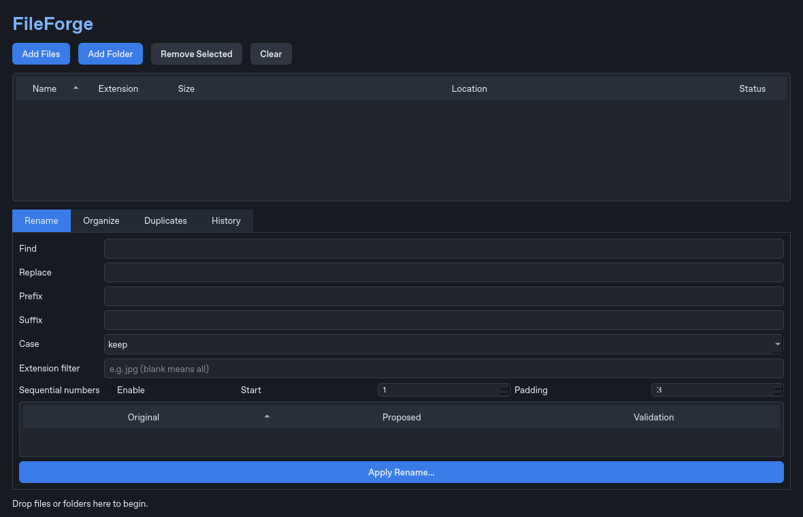

# FileForge

FileForge is a Windows-first desktop utility for safe batch renaming, organization, duplicate discovery, quarantine, and undo. Every write operation is previewed and confirmed; FileForge never permanently deletes files or silently overwrites a destination.

## Features

- Dark, scalable PySide6 interface with sortable tables, real drag-and-drop, keyboard shortcuts, context menus, progress, and persistent preferences.
- Live batch rename previews with find/replace, prefix/suffix, padded numbering, case conversion, and extension filters.
- Collision, invalid-name, Windows reserved-name, and changed-since-preview detection.
- Extension, category, and custom organization rules with destination previews.
- Recursive, symlink-safe duplicate scanning with size grouping, streamed SHA-256 verification, potential-savings totals, and recoverable quarantine.
- Persistent operation history with status, details, selectable undo, and cycle-safe rollback.
- Threaded hashing and filesystem operations keep the interface responsive.
- 100+ automated checks plus Ruff, PyInstaller, and Windows/Linux GitHub Actions CI.

## Screenshots



The main window presents a sortable file inventory above four focused workflows: Rename, Organize, Duplicates, and History. The image is an automated offscreen capture; release screenshots should also be captured on native Windows so system rendering is represented accurately.

## Install and run

Requires Python 3.11 or newer.

```bash
python -m pip install -e '.[dev]'
fileforge
```

## Usage

1. Add or drag files and folders into the inventory.
2. Configure a rename or organization rule and inspect every proposed destination.
3. Confirm the operation. FileForge revalidates source stamps and destination collisions immediately before changing anything.
4. Use **Duplicates** for read-only discovery. Quarantine is optional and always requires a recoverable destination plus confirmation.
5. Use **History** to inspect and undo a completed operation when filesystem state remains safe.

## Development

```bash
ruff check .
pytest -q
pyinstaller --noconfirm --windowed --name FileForge fileforge/app.py
```

The Windows executable is written to `dist/FileForge/FileForge.exe`.

## Safety notes

FileForge never auto-deletes duplicate files, never intentionally overwrites an existing destination, skips symlinks while scanning, serializes conflicting writes, and requires explicit confirmation. Failed transactions attempt rollback and record diagnostic details. If both the operation and rollback are interrupted, `.fileforge-*.pending` files are intentionally retained as recoverable evidence.

See the [user guide](docs/user-guide.md), [architecture](docs/architecture.md), [example workflows](docs/example-workflows.md), [troubleshooting guide](docs/troubleshooting.md), and [changelog](CHANGELOG.md).
